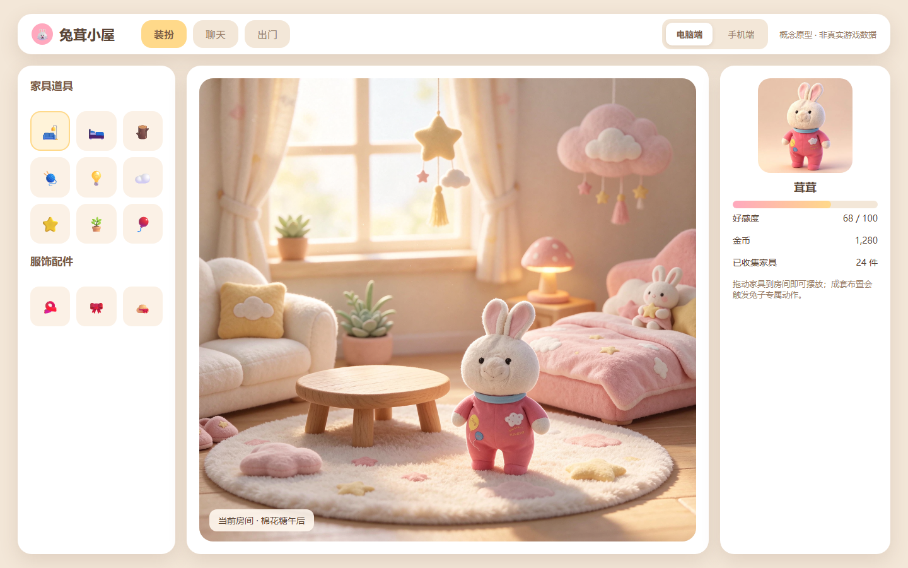
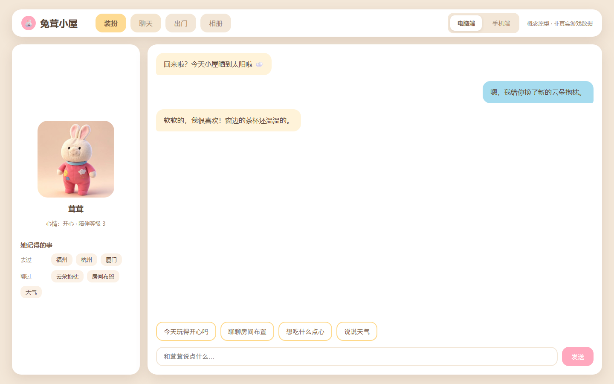
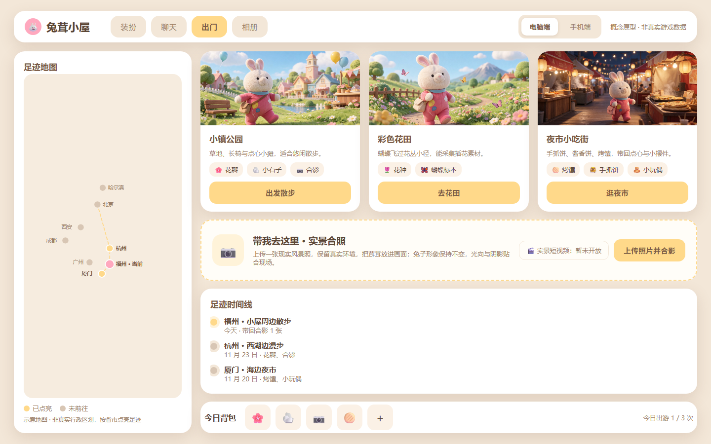
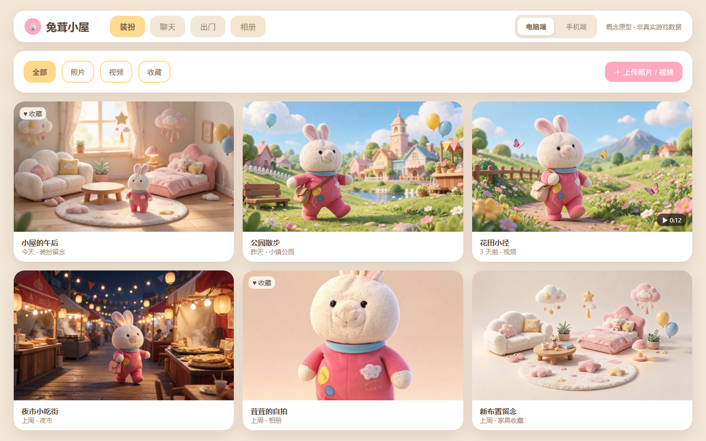
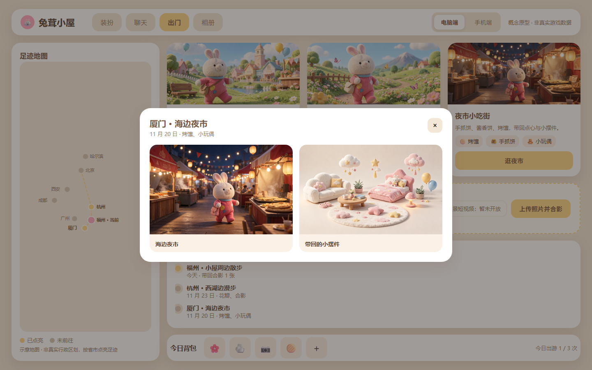

# 兔茸小屋 · Rabbit Cottage

一款治愈系兔子小屋装扮陪伴游戏的 **HTML 静态界面原型**。包含装扮布置、陪伴聊天、出门足迹、回忆相册四个核心界面，并提供电脑横屏与手机竖屏双端布局预览。

> 本仓库为概念界面稿：界面文案、好感度、金币、足迹与记忆标签均为占位演示数据，尚未接入真实后端、账号体系与云存档。

## 界面预览

### 装扮
左侧家具 / 服饰道具栏，中间房间预览，右侧角色立绘、好感度与金币信息。



### 聊天
角色卡片、对话气泡、话题快捷选项与输入框；角色卡下方「她记得的事」沉淀聊过的话题与去过的地方。



### 出门 · 足迹地图与时间线
左侧为示意足迹地图，未前往省市为灰色，去过的省市点亮、当前地高亮；右侧是场景卡片、实景合照入口，以及按时间倒序的足迹时间线。



### 相册
照片 / 视频回忆墙，支持全部、照片、视频、收藏筛选，带收藏标记与视频时长角标。



### 地点回忆回看
点击地图上已点亮的地点或时间线条目，弹出该次出游的照片与视频回忆；未前往的地点不可点。



## 功能一览

- **装扮**：家具 / 服饰道具栏、房间预览、角色好感度与金币（占位）。
- **聊天**：对话气泡、话题快捷选项、输入演示；「她记得的事」记忆标签。
- **出门**：点亮式足迹示意地图、足迹时间线、场景卡片、实景合照上传入口（短视频位预留）。
- **相册**：照片 / 视频网格、分类筛选、收藏与上传入口。
- **回忆回看**：地图节点与时间线联动，弹出对应地点的照片 / 视频回忆弹层。
- **双端布局**：顶部可切换电脑端 / 手机端预览，手机端为单列竖屏布局方向。

## 目录结构

```
game-prototype/
├── index.html          # 原型主文件（HTML + CSS + JS 全部内嵌，单文件可运行）
├── README.md           # 本说明
├── .gitignore
└── assets/             # 界面预览截图（README 引用）
    ├── decorate.png
    ├── chat.png
    ├── goout.png
    ├── album.png
    └── memory-modal.png
```

## 本地运行

无需构建、无第三方依赖。直接双击 `index.html` 用浏览器打开即可；或在本目录启动一个静态服务：

```bash
# 任选其一
python -m http.server 8080
# 或
npx serve .
```

然后访问 `http://localhost:8080`。

## 部署到 GitHub Pages

### 1. 在 GitHub 新建空仓库

例如命名为 `rabbit-cottage-prototype`，**不要**勾选 “Add a README”、不要添加 `.gitignore` 或 License，保持空仓库。

### 2. 推送代码

在本目录打开终端：

```bash
git init
git add .
git commit -m "feat: 兔茸小屋概念原型（装扮/聊天/出门/相册/回忆回看，双端布局）"
git branch -M main
git remote add origin https://github.com/<你的用户名>/rabbit-cottage-prototype.git
git push -u origin main
```

### 3. 开启 Pages

仓库 **Settings → Pages**：

- Source 选择 `Deploy from a branch`
- Branch 选择 `main`，目录选择 `/ (root)`
- 保存后等待几分钟，即可通过以下地址在线预览：

```
https://<你的用户名>.github.io/rabbit-cottage-prototype/
```

## 素材说明

- 原型中角色与场景图使用在线图片链接（演示用 CDN 短链）。若需要完全离线可打开的仓库，可将图片下载到本地 `assets/` 目录，并把 `` 改为相对路径，例如：

  ```html
  
  ```

- 地图为示意节点图，不对应真实行政区划边界；正式版本可替换为合规的地图组件。

## 角色设定锚点

所有画面中的兔子形象保持一致：白色绒毛、粉色内耳、黑圆眼睛、圆润体型、粉色连体衣、浅蓝色项圈，衣上有黄蓝气球与白云朵刺绣，耳朵比例适中。

## 占位数据与后续规划

当前为前端原型，以下能力留待后续接入：

- 手机号验证码登录流程（需配合短信服务、隐私政策与用户协议）。
- 云存档与账号互通，相册云端同步。
- 记忆系统持久化：聊天话题与出游足迹跨会话保留，并在对话中引用。
- 家具拖拽摆放、穿搭试穿的真实交互。
- 实景照片静态合照合成（背景保真、角色身份锁、光向阴影匹配）；实景短视频待视频创作额度恢复后接入。
- 回忆弹层接入真实相册媒体：视频在线播放、照片大图查看、按地点自动归集合影与纪念品。

## 浏览器兼容

使用现代浏览器（Chrome / Edge / Firefox / Safari 最新版本）打开即可；原型未兼容 IE。
